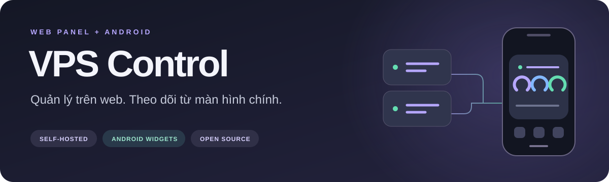
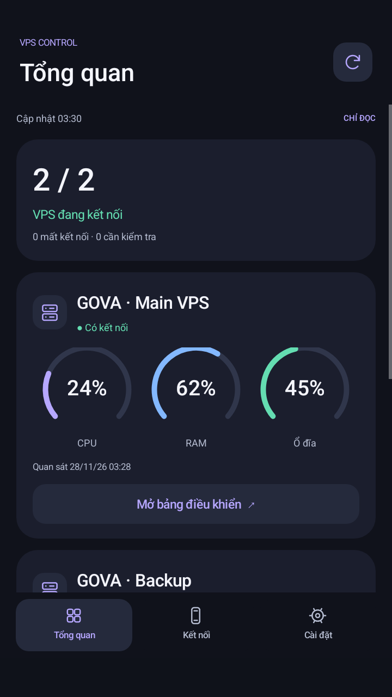
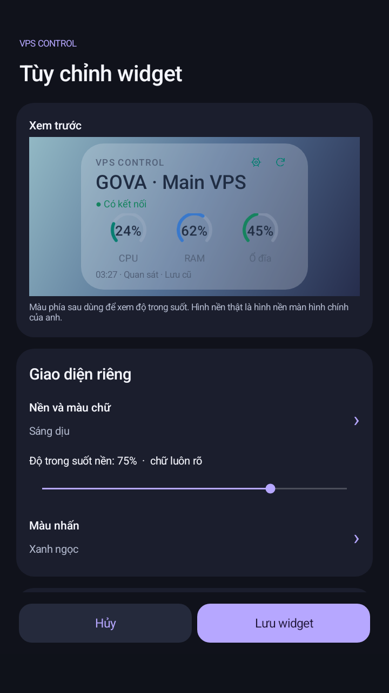
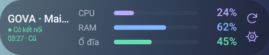

<p align="center">
  
</p>

<p align="center">
  <a href="https://github.com/Milunice259/vps-assistant-for-no-code-user/releases/tag/android-v1.3.0"></a>
  
  
  <a href="LICENSE"></a>
</p>

<p align="center">
  <strong>Biết VPS nào cần chú ý. Hiểu cảnh báo. Thao tác đúng máy chủ.</strong><br/>
  Bảng điều khiển tự host cho người vận hành, cùng ứng dụng Android và widget gọn nhẹ.
</p>

<p align="center">
  <a href="https://github.com/Milunice259/vps-assistant-for-no-code-user/releases/download/android-v1.3.0/VPS-Control-Widget-1.3.0.apk"><strong>Tải APK 1.3.0</strong></a> ·
  <a href="docs/INSTALLATION.md">Cài web panel</a> ·
  <a href="docs/android/README.md">Bắt đầu với Android</a> ·
  <a href="docs/README.md">Tài liệu</a> ·
  <a href="CONTRIBUTING.md">Đóng góp</a>
</p>

---

## Một nơi để nhìn toàn bộ hệ VPS

VPS Control giúp trả lời những câu hỏi thường gặp: máy chủ còn khỏe không, ứng dụng nào đang lỗi, cảnh báo có ý nghĩa gì và bước tiếp theo nên làm gì. Web panel tập trung việc quản lý; Android đưa trạng thái và tài nguyên ra ngay màn hình chính.

| Trên web | Trên điện thoại |
| --- | --- |
| Tổng quan nhiều VPS, cảnh báo và lịch sử tài nguyên | Xem nhanh CPU, RAM, ổ đĩa và thời điểm quan sát |
| Quản lý máy chủ local/remote, Docker và systemd | Chọn một hoặc nhiều VPS riêng cho từng widget |
| Xem log, health check, triển khai Git/Image/Compose | Chỉnh nền, độ trong suốt, màu nhấn và cách hiển thị |
| Phân quyền, Advanced Mode, nhật ký thao tác | Ghép nối bằng mã một lần; API thiết bị chỉ đọc |
| Backup nhất quán cho database của panel | Kiểm tra phiên bản GitHub và cập nhật trong app |

## Xem trước ứng dụng

<table>
  <tr>
    <td align="center" width="50%"><strong>Tổng quan tài nguyên</strong></td>
    <td align="center" width="50%"><strong>Tùy chỉnh từng widget</strong></td>
  </tr>
  <tr>
    <td align="center"></td>
    <td align="center"></td>
  </tr>
</table>

<p align="center">
  
</p>

<p align="center"><sub>Ảnh từ bộ kiểm thử Android với số liệu minh họa. <a href="docs/assets/README.md">Nguồn ảnh và phiên bản</a>.</sub></p>

## Android 1.3.0 có gì?

- **Bốn mẫu widget:** tổng quan, một VPS, thanh ngang 4×1 và khung chi tiết. Bố cục thích ứng khi kéo đổi kích thước.
- **Giao diện theo ý bạn:** sáng/tối/theo app, nền trong suốt 0–100%, bốn màu nhấn, đồng hồ/thanh/số và mật độ danh sách. Có preview, Lưu, Hủy và Khôi phục mặc định.
- **Nhịp cập nhật linh hoạt:** 1/3/5/15/30/60 phút; app chính đang mở tự cập nhật mỗi phút. Nhiều widget dùng chung một lần lấy dữ liệu.
- **Số liệu có ngữ cảnh:** kèm giờ quan sát. Số liệu hợp lệ đã cũ được đánh dấu **Đã lưu**, tối đa 24 giờ, và không được tính là VPS đang online hiện tại.
- **Nhỏ gọn:** APK stable 1.3.0 có **83.494 byte**, Android 10+, không có thư viện runtime bên thứ ba.
- **VI / EN:** chọn ngôn ngữ và giao diện trong ứng dụng.

Nhịp widget 1/3/5 phút cần quyền **Báo thức và lời nhắc** trên Android 12+. Khi chưa bật quyền, app ghi rõ lịch nền dự phòng 15 phút. Máy ngủ, Doze hoặc chế độ tiết kiệm pin của hãng có thể làm trễ cập nhật; lịch nhanh không đánh thức máy mỗi phút.

### Cài và ghép nối

1. Cài [APK stable](https://github.com/Milunice259/vps-assistant-for-no-code-user/releases/tag/android-v1.3.0). Khi nâng cấp stable, cài đè để giữ dữ liệu và widget.
2. Trên panel có Mobile API, vào **Settings → Mobile Devices**, chọn VPS và tạo mã một lần, hiệu lực 5 phút.
3. Trên Android, nhập URL HTTPS gốc của panel và mã ghép nối. Điện thoại không cần mật khẩu quản trị hay khóa SSH.
4. Thêm widget từ **Cài đặt** hoặc màn hình chính. Chạm bánh răng để chọn VPS và tùy chỉnh; chọn nhịp cập nhật trong cài đặt app.

Xem [hướng dẫn Android](docs/android/README.md), [thông tin xác minh APK](docs/android/STATUS.md) và [feed stable](android/releases/stable.json).

## Web panel: từ quan sát đến xử lý

| Khu vực | Công việc chính |
| --- | --- |
| **Dashboard & Servers** | Sức khỏe đội VPS, Fleet Risk Score, cảnh báo, chỉ số tài nguyên và lịch sử |
| **Apps & Services** | Container, systemd, log, môi trường chạy, health check và tài nguyên ứng dụng |
| **Deploy** | Phân tích Git local; triển khai Git remote, Docker Image hoặc Compose |
| **Network** | Bản đồ domain/proxy/port/network và kiểm tra quy tắc mạng theo quyền |
| **Backups** | Snapshot SQLite nhất quán của panel, có kiểm tra integrity |
| **Notifications** | Kênh Telegram, Discord, Slack, Email và quy tắc cảnh báo |
| **Users, Settings & Audit** | Vai trò, phạm vi VPS, cấu hình và lịch sử thao tác |

Thao tác thay đổi máy chủ dùng quyền theo đối tượng, Advanced Mode tạm thời và xác nhận theo hành động. SSH kiểm tra fingerprint đã tin cậy. Thông tin đăng nhập nhạy cảm được mã hóa khi lưu; API mobile chỉ đọc snapshot theo phạm vi thiết bị.

Backup panel chứa **database panel**, không thay thế backup ứng dụng, volume hay khóa mã hóa. Khôi phục database đang chạy và tự động rollback deployment chưa được cung cấp. Web panel có quyền quản trị host trong cấu hình Compose hiện tại; đọc [hướng dẫn cài đặt và vận hành](docs/INSTALLATION.md) trước khi triển khai.

## Tự host và phát triển

Để cài panel trên VPS Ubuntu/Debian phù hợp, bắt đầu bằng [hướng dẫn cài đặt](docs/INSTALLATION.md). Script `deploy.sh` có thể cài Docker, cấu hình Traefik và firewall; trên máy đang chạy dịch vụ khác, cần xem lại cấu hình hiện hữu trước khi chạy.

```bash
git clone https://github.com/Milunice259/vps-assistant-for-no-code-user.git
cd vps-assistant-for-no-code-user
```

Sau khi cấu hình môi trường và tài khoản theo hướng dẫn, các lệnh phát triển chính là:

```bash
npm ci
npm run db:generate
npm run db:push
npm run dev
```

| Thành phần | Công nghệ |
| --- | --- |
| Web / API | Next.js 16, React 19, TypeScript |
| Giao diện | Tailwind CSS, Lucide, Recharts |
| Dữ liệu / collector | SQLite, Prisma, worker giám sát riêng trong cùng container |
| Hạ tầng | Docker Compose, Traefik, SSH, systemd |
| Android | Java, Android SDK, RemoteViews, Keystore; min API 29 |

## Tài liệu và đóng góp

- [Trung tâm tài liệu](docs/README.md) — kiến trúc và bản đồ repo.
- [Cài đặt và vận hành](docs/INSTALLATION.md) — host mới, môi trường local, backup và cập nhật.
- [Android](docs/android/README.md) — ghép nối, widget, nhịp cập nhật và xử lý sự cố.
- [Phát triển](docs/DEVELOPMENT.md) · [API & database](docs/API-AND-DATABASE.md) · [Đóng góp](CONTRIBUTING.md).
- [Trạng thái Android](docs/android/STATUS.md) · [Roadmap gốc](docs/android/ROADMAP.md) · [Lịch sử checkpoint](docs/android/archive/README.md).

Hướng đóng góp phù hợp: trải nghiệm dễ hiểu, bản dịch, cách trình bày cảnh báo, tích hợp giám sát và kiểm thử thao tác có rủi ro. Báo cáo lỗ hổng qua kênh riêng của maintainer hoặc GitHub Security Advisories nếu được bật; tránh đưa bí mật vào issue công khai.

Mã nguồn theo giấy phép [MIT](LICENSE).
