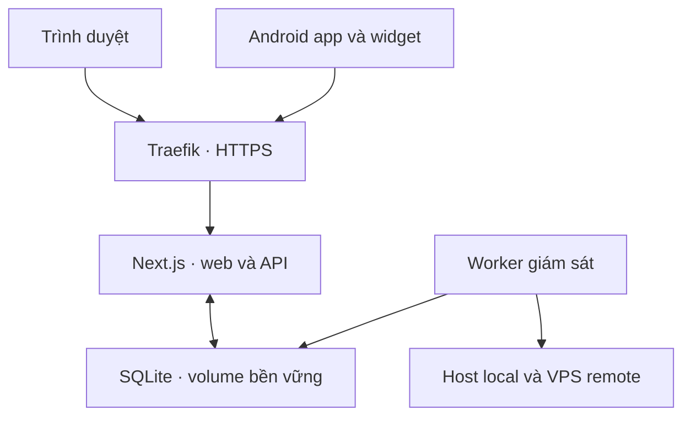

# VPS Control — trung tâm tài liệu

Web panel và ứng dụng Android cùng dùng backend giám sát. Bắt đầu theo việc bạn muốn làm:

| Mục tiêu | Tài liệu |
| --- | --- |
| Hiểu sản phẩm, tải APK | [README chính](../README.md) |
| Cài panel, chuẩn bị môi trường local | [Cài đặt và vận hành](INSTALLATION.md) |
| Ghép nối điện thoại, chỉnh widget | [Hướng dẫn Android](android/README.md) |
| Xác minh bản Android đã phát hành | [Trạng thái hiện tại](android/STATUS.md) |
| Tìm tính năng web | [Capabilities](CAPABILITIES-SUMMARY.md) |
| Đọc API và model | [API & database](API-AND-DATABASE.md), [Mobile API](android/MOBILE-API.md) |
| Sửa giao diện, mở PR | [Development](DEVELOPMENT.md), [Contributing](../CONTRIBUTING.md) |
| Build, ký và phát hành Android | [Release](android/RELEASE.md), [Updates](android/UPDATES.md) |
| Đọc quyết định/checkpoint cũ | [Kho lịch sử](android/archive/README.md) |

## Kiến trúc hiện tại

Next.js và worker là **hai process trong cùng container**, được entrypoint giám sát. Worker thu thập theo chu kỳ và ghi snapshot/history. Mobile API đọc snapshot theo quyền thiết bị; một GET từ widget không tạo lệnh SSH mới. Volume `app_data` giữ database qua lần thay container.

Web đăng nhập bằng cookie; Android ghép nối bằng mã một lần và dùng bearer riêng. Các thay đổi server cần quyền phù hợp và Advanced Mode tạm thời. SSH yêu cầu fingerprint đã được xác minh/tin cậy. Xem [Compose](../docker-compose.yml) và [entrypoint](../docker-entrypoint.sh) trước khi vận hành.

## Bản đồ repo

| Đường dẫn | Vai trò |
| --- | --- |
| `src/app/`, `src/components/`, `src/lib/` | Web, API, giao diện và nghiệp vụ |
| `prisma/schema.prisma` | Schema SQLite và Prisma |
| `scripts/` | Worker, regression checks và công cụ vận hành có phân loại |
| `tests/` | Kiểm thử mobile backend |
| `android/app/` | App Java, RemoteViews, build và native instrumentation |
| `android/releases/stable.json` | Feed stable đã ký |
| `android/owner-signer/` | Bộ ký/xác minh tùy chọn trên máy do chủ dự án quản lý |
| `.github/workflows/` | QA Android, mobile backend và công cụ ký |
| `docs/assets/` | Banner và ảnh minh họa có nguồn gốc |
| `docs/android/archive/` | Checkpoint cũ; không dùng làm trạng thái hiện tại |

## Khi tiếp tục công việc

Đọc source/HEAD, [trạng thái Android](android/STATUS.md), [feed stable](../android/releases/stable.json), release/tag và checkpoint PR tương ứng. Roadmap và lịch sử giải thích quyết định cũ; trạng thái ở checkpoint cũ có thể đã được bản mới thay thế.

Các trang API/capabilities dài là tài liệu tham khảo. Source, schema, workflow và release đã xác minh quyết định hành vi hiện tại.
